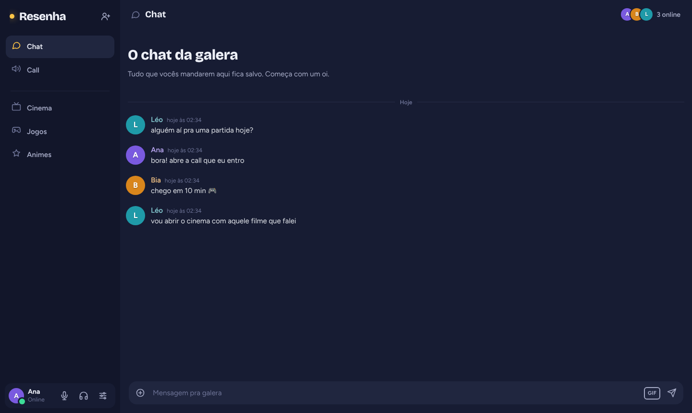
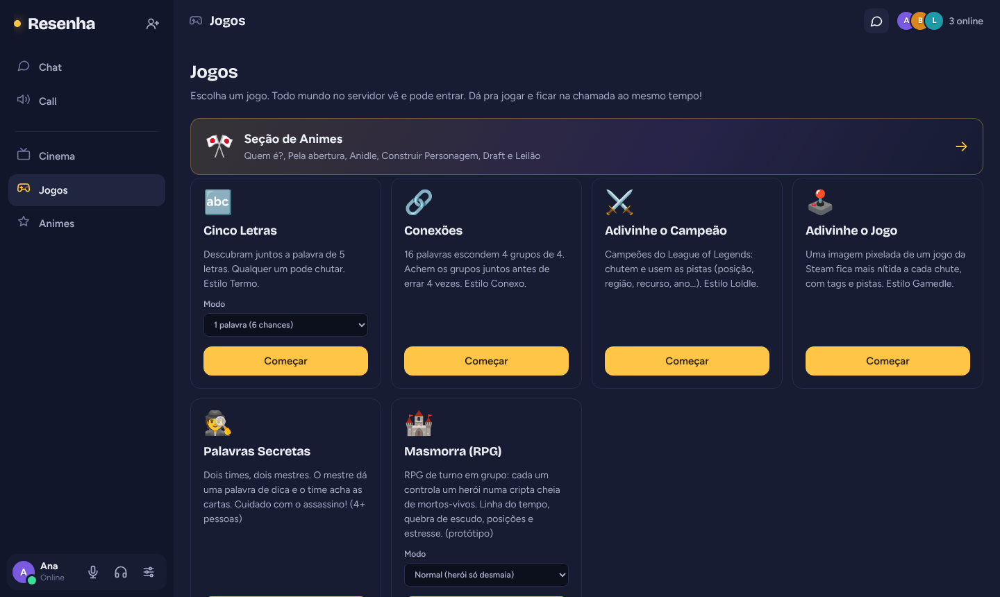
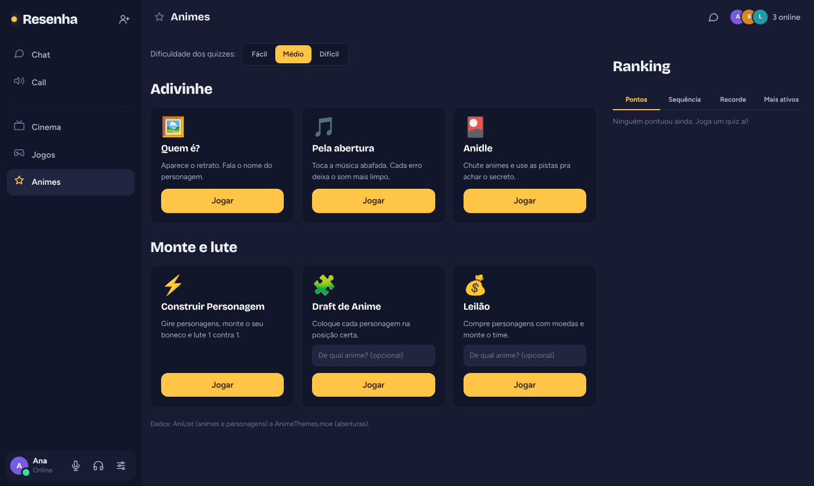
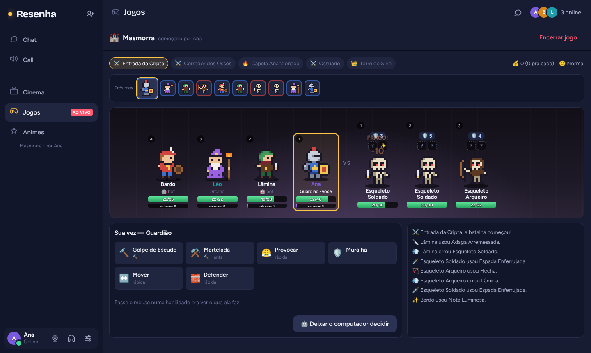

# Resenha

Um lugar só da sua galera: chat, call com câmera e tela, cinema sincronizado e um monte de jogo pra jogar junto. Roda no seu próprio PC, sem conta, sem assinatura e sem ninguém no meio.

  <a href="https://github.com/kassaiw/Aplicativo-de-mensagem-/archive/refs/heads/main.zip"><b>⬇️ Baixar o Resenha (.zip)</b></a>

## O que tem

- **Chat** com imagens, GIFs, spoiler e mensagens que ficam salvas.
- **Call** com microfone, câmera e compartilhamento de tela com som.
- **Cinema**: todo mundo assiste o mesmo vídeo do YouTube (ou um arquivo do PC) no mesmo segundo.
- **Jogos**: Cinco Letras (estilo Termo), Conexões, Adivinhe o Campeão (estilo Loldle), Adivinhe o Jogo (estilo Gamedle), Palavras Secretas e a **Masmorra**, um RPG de turno em grupo.
- **Animes**: Quem é? (adivinhe o personagem), adivinhe pela abertura, Anidle, Construir Personagem, Draft e Leilão, com ranking da galera.
- **Admin** pra apagar mensagem, silenciar, mutar e banir.

| | |
|---|---|
|  |  |

## Como usar

Só quem vai **hospedar** precisa baixar. Os amigos só abrem o link no navegador.

1. Instale o [Node.js](https://nodejs.org) (versão LTS).
2. [Baixe o Resenha](https://github.com/kassaiw/Aplicativo-de-mensagem-/archive/refs/heads/main.zip) e descompacte numa pasta.
3. No Windows, rode `instalar-cloudflared.bat` uma vez (ele cria o link pros amigos entrarem de fora).
4. Dê dois cliques em `iniciar.bat`. No Mac ou Linux: `sh iniciar-mac-linux.sh`.
5. A janela mostra o **link dos amigos**. Manda no grupo e pronto.

O passo a passo completo (GIFs, TURN pra quem não conecta, admin, cada jogo explicado) está no **[LEIA-ME](LEIA-ME.md)**.

## Como funciona por dentro

- `server.js`: o servidor, em Node.js puro, **sem nenhuma biblioteca**. Ele entrega o site, cuida do chat e "apresenta" os navegadores uns pros outros.
- Áudio, câmera e tela vão **direto de um PC pro outro** (WebRTC), sem passar pelo servidor.
- `jogos/`: as regras de cada jogo ficam no servidor, pra ninguém roubar. A Masmorra tem o motor de combate separado em `jogos/rpg/` (o design está em [docs/RPG.md](docs/RPG.md)).
- `public/`: a parte que roda no navegador.

O que é seu (senhas, código de admin, histórico do chat) fica em `config.json` e na pasta `dados/`, que **não** vão pro GitHub.

## Créditos

- Dados de anime: [AniList](https://anilist.co). Aberturas: [AnimeThemes.moe](https://animethemes.moe). Campeões: Riot Data Dragon e Meraki Analytics. Jogos: SteamSpy e Steam. GIFs: GIPHY.
- Fontes: Bricolage Grotesque e Figtree (SIL Open Font License).
- Feito por [Otaviodev](https://github.com/kassaiw) com a ajuda do Claude.

## Licença

[MIT](LICENSE): pode usar, mudar e compartilhar à vontade.
